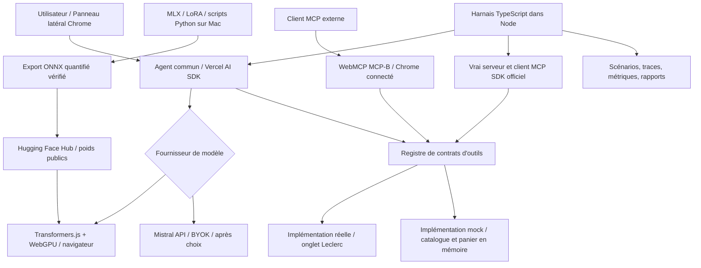

# Cahier des charges — Assistant de recettes et courses Leclerc Drive

**Statut :** PROPOSITION SOUMISE À REVUE PAR PULL REQUEST — **non fusionnée et non validée définitivement**.  
**Date :** 18 octobre 2026  
**Dépôt cible :** [`maurice30120/mcp-leclerc-drive`](https://github.com/maurice30120/mcp-leclerc-drive)  
**Fichier soumis à revue :** `cahier-des-charges.md` à la racine, introduit exclusivement par pull request.  
**Origine :** décisions validées lors du cadrage *GrillMe* (Q1–Q36), avec ajustements ultérieurs prioritaires.

---

## 1. Objet et philosophie

Faire évoluer `mcp-leclerc-drive` en **assistant de préparation de recettes et de courses** avec deux accès complémentaires :

1. **Agent intégré à l'extension Chrome** : conversation dans le panneau latéral, génération de recettes, préparation de la liste de courses, recherche de produits, puis modification du panier uniquement après confirmation de l'utilisateur.
2. **Outils MCP** : les fonctionnalités Leclerc sont exposées aux clients MCP externes, dans l'environnement navigateur déjà connecté, sans imposer le moteur d'agent interne à ces clients.

Les deux voies s'appuient sur les **mêmes définitions d'outils et la même logique métier**, avec des implémentations adaptables à l'environnement. **Le harnais local Node.js doit pouvoir exécuter le véritable agent et un véritable serveur MCP**, avec **tous les appels aux outils Leclerc bouchonnés**, sans simuler le navigateur ni les requêtes réseau.

**Finalité première : apprentissage et expérimentation.** Comprendre la spécialisation d'un petit LLM par fine-tuning LoRA, comparer le modèle brut au modèle spécialisé et à Mistral, et tester les limites d'un modèle embarqué. On privilégie la simplicité, la transparence des expériences et des tests reproductibles plutôt que la richesse fonctionnelle immédiate.

### 1.1 Principes non négociables

- Runtime agent **dans le navigateur** pour l'utilisateur de l'extension ; aucun backend applicatif permanent requis.
- Chrome sur **macOS, Windows et Linux** est le périmètre cible ; compatibilité réelle à vérifier sur chaque OS, sans supposer des performances identiques.
- Inférence des **vrais modèles locaux par WebGPU exclusivement** ; **aucun repli CPU/WASM** pour le LLM dans le produit ni dans les tests d'inférence réels du harnais.
- Si le local est indisponible, **proposer** Mistral, mais **jamais de bascule ni d'appel API payant automatiques** ; demander confirmation.
- Hébergement public des poids du modèle sur **Hugging Face**, téléchargement à la demande avec consentement, cache local ; pas de poids géants dans le paquet de l'extension.
- **BYOK Mistral** : l'utilisateur fournit sa propre clé API ; aucun proxy applicatif intermédiaire prévu.
- Les prix, références produit, disponibilité et tailles commerciales **ne proviennent jamais du LLM** : seuls les outils/catalogues ont autorité sur ces données.
- **Aucune obligation de rétrocompatibilité** : le logiciel n'étant pas en production, les interfaces internes et publiques peuvent changer. On préserve en revanche la couverture des neuf fonctionnalités existantes.
- **Aucun changement direct sur `main`**. Le présent texte est une proposition : après validation seulement, création d'une branche et d'une **pull request**. Ne pas fusionner sans décision explicite.

### 1.2 Première livraison (*vertical slice*)

Un utilisateur demande par exemple : « Proposez un poulet au curry sans crème pour quatre personnes et préparez les courses. » L'agent :

1. comprend la demande et propose **une seule recette** en français ;
2. fournit une recette **JSON structurée**, validée strictement ;
3. extrait/normalise les ingrédients et quantités nécessaires ;
4. appelle la recherche d'articles sur un **catalogue mocké** (dans le harnais), sans jamais inventer d'identifiant produit ;
5. prépare la sélection et le panier **sans aucune mutation préalable** ;
6. attend **une approbation globale** ;
7. ajoute les articles sélectionnés au panier mocké, ou ne modifie rien en cas de refus/erreur préalable ;
8. expose une trace évaluable : texte, JSON, outils, erreurs, temps et scores.

Dans le produit Chrome, le parcours réel viendra après validation du parcours Node. Le premier prototype n'inclut **ni planification hebdomadaire**, ni optimisation avancée du budget, ni paiement/checkout.

## 2. État existant du dépôt et stratégie d'évolution

L'état examiné sur `main` au moment de la rédaction comprend notamment :

- `extension/inject.ts` : enregistrement WebMCP des neuf outils via `@mcp-b/global` et relais compatible MCP-B ; accès Leclerc dans l'onglet connecté.
- `src/leclerc/api.ts` : helpers métier essentiellement purs, sans `fetch`, réutilisables.
- `src/types.ts` : types `Product`, `CartItem`, `Cart`.
- `src/orchestrator/*` : normalisation déterministe de listes, plans et workflow, avec notamment `prompt.ts`, `plan.ts`, `workflow.ts`, `models.ts`.
- `extension/popup/*`, `extension/offscreen/*`, `extension/background.ts` : une **popup et un orchestrateur local Transformers.js existent déjà** ; la logique actuelle normalise une **liste de courses explicite**, **ne génère pas de recettes**, embarque des modèles et privilégie à certains endroits WASM CPU.
- `scripts/fetch-model.mjs` : gestion actuelle de modèles intégrés au build.
- `tests/*` : tests actuels Node (`node:test`) et smoke tests d'inférence, avec des limites connues de stabilité de certains modèles ONNX dans Chrome.
- `docs/architecture.md`, `docs/orchestrator.md`, `docs/security.md`, `docs/tools.md` : documentation à mettre à jour pendant la refonte.

**Décision de migration :** refactoriser progressivement cette base, **réutiliser ses utilitaires et ses tests pertinents**, supprimer les duplications, et remplacer la normalisation strictement « liste explicite » par un scénario de recette **dans un module distinct**. Les anciennes garanties de sécurité Leclerc (requêtes depuis l'onglet, contrôle de l'hôte, contenu non fiable) doivent subsister.

**Attention :** ce projet est une refonte fonctionnelle ; aucune compatibilité binaire ou contractuelle avec les anciens noms/schémas d'outils n'est exigée. Toute suppression de fonctionnalité existante doit néanmoins apparaître explicitement dans la PR.

## 3. Architecture cible



**Note d'architecture :** le registre commun décrit **quoi appeler** ; l'injection dépend du contexte. En environnement Node, tous les outils utilisent les mocks. Dans Chrome, ils utilisent l'implémentation Leclerc. L'agent intégré appelle les outils directement via son adaptateur AI SDK (sans transport MCP inutile). Les clients MCP externes utilisent le transport MCP réel ; le harnais teste le vrai protocole avec serveur et client SDK officiels.

### 3.1 Séparation en packages npm workspaces

Arborescence **cible proposée**, sujette aux choix de refactoring de l'implémentation (pas une obligation de chaque nom) :

```text
mcp-leclerc-drive/
  package.json                  # npm workspaces ; scripts racine
  packages/
    domain/                     # Recipe, Ingredient, Product, Cart, erreurs
    tool-contracts/             # Schémas, annotations, registre de définition
    leclerc-core/               # Logique métier pure existante, migrée progressivement
    leclerc-browser/            # Implémentation réelle dans l'onglet Chrome
    tools-mock/                 # État catalogue/panier, scénarios, erreurs injectables
    agent/                      # Agent partagé, prompts, validations, providers
    provider-transformers/      # Inférence Transformers.js / WebGPU
    provider-mistral/           # BYOK, configuration, API Mistral
    mcp-browser/                # Projection du registre vers WebMCP / MCP-B
    mcp-node/                   # Projection du registre vers MCP SDK officiel
    harness/                    # CLI Node, Vitest, scénarios, métriques, rapports
  extension/
    background/                 # cycle de vie MV3, injection, communications
    sidepanel/                  # interface conversationnelle
    offscreen/                  # contexte d'inférence si nécessaire/justifié
  training/
    README.md
    pyproject.toml              # ou requirements verrouillés
    config/                     # hyperparamètres, chemins, seeds
    scripts/                    # analyse, préparation, train, eval, fusion, export
    data/                       # données locales, non committées si volumineuses
  scenarios/                    # fixtures et cas de test versionnés
  docs/
  cahier-des-charges.md
```

Démarrer **avec le plus petit nombre raisonnable de packages** ; ne créer un package séparé que si sa frontière de dépendances a un intérêt réel. Éviter toute dépendance de `domain`/`tool-contracts` à `chrome.*`, `window`, `document`, `node:*`, SDK MCP ou bibliothèques de modèles.

### 3.2 Bibliothèques prioritaires

| Besoin | Solution visée | Statut |
|---|---|---|
| Modèles locaux | `@huggingface/transformers` v4+ | Choix validé ; vérifier version/compatibilité |
| Intégration modèle ↔ agent | `@browser-ai/transformers-js` | Option documentée ; **POC obligatoire** pour tool calling réel |
| Orchestration | `ai` / `ToolLoopAgent` de Vercel AI SDK | Choix validé ; limites d'étapes configurables |
| Modèle cloud | SDK/provider Mistral compatible AI SDK, ou adaptateur minimal | Valider disponibilité navigateur/CORS |
| MCP navigateur | `@mcp-b/global`, WebMCP et `@mcp-b/webmcp-local-relay` si nécessaire | Existant ; garder uniquement les composants utiles |
| MCP Node | `@modelcontextprotocol/server`, `@modelcontextprotocol/client` v2 | Serveur/client réels dans les tests |
| Validation | Zod ou JSON Schema partagé ; une seule source de vérité | Exigé |
| Tests | Vitest + harness CLI TypeScript | Choix validé ; migration progressive des tests actuels |
| Fine-tuning Apple Silicon | MLX / MLX-LM et LoRA | Choix validé ; Python isolé |

**Contraintes sur les dépendances :** versions épinglées/lockfile ; pas de framework agent additionnel sans bénéfice démontré ; pas de serveur HTTP pour l'agent ; pas de Docker obligatoire. Les exemples d'intégration officiels ne constituent pas une garantie que chaque petit modèle gère correctement des appels d'outils : le prouver en POC.

### 3.3 Contextes d'exécution

- **Chrome / panneau latéral** : interface utilisateur, sélection du provider, historique de session, consentements, revue du panier.
- **Chrome / contexte extension approprié** : modèle local sur WebGPU hors du thread UI (worker ou document offscreen si nécessaire). Préserver le fonctionnement lors des suspensions du service worker MV3 ; ne pas compter sur un état uniquement détenu par ce worker.
- **Chrome / onglet Leclerc** : session authentifiée, recherches et mutations autorisées, validation de l'hôte. Ne pas extraire/dupliquer les cookies.
- **Node / harnais** : même package `agent` et mêmes contrats d'outils ; providers réels (Mistral et Transformers.js WebGPU) ; mocks d'outils ; aucun Chrome ni réseau Leclerc.
- **Node / MCP tests** : SDK MCP serveur **réel** exposant l'implémentation mockée et client **réel** sur stdio/transport adapté aux tests ; tester `tools/list`, `tools/call`, schémas, erreurs.
- **Python / training** : MLX/LoRA, indépendant des dépendances JavaScript ; produit poids, métriques et artefacts exportés.

## 4. Domaine et contrat des recettes

### 4.1 Entrée utilisateur (V1)

Une demande libre en français pouvant contenir : nom du plat, ingrédients souhaités, ingrédients exclus, nombre de personnes. Si une information indispensable manque, l'agent pose une **question ciblée** au lieu d'inventer des contraintes. La génération d'une seule recette est le scénario de référence.

### 4.2 JSON de recette (exemple illustratif)

```json
{
  "schemaVersion": 1,
  "title": "Poulet au curry sans crème",
  "servings": 4,
  "preparationMinutes": 15,
  "cookingMinutes": 25,
  "ingredients": [
    { "name": "blanc de poulet", "quantity": 600, "unit": "g", "optional": false },
    { "name": "lait de coco", "quantity": 400, "unit": "ml", "optional": false },
    { "name": "curry", "quantity": 2, "unit": "c. à café", "optional": false }
  ],
  "steps": [
    "Couper le poulet en morceaux.",
    "Faire revenir le poulet et ajouter le curry.",
    "Verser le lait de coco et laisser mijoter."
  ]
}
```

Cet exemple vise la **forme** ; il ne doit pas être utilisé comme référence culinaire complète pour évaluer une recette. Définir un schéma partagé/versionné avec : chaînes non vides, portions entier positif, quantités numériques strictement positives, unités contrôlées ou normalisées, ingrédients sans `product_id`, étapes ordonnées, champs additionnels explicitement permis ou interdits. Les durées sont facultatives si non disponibles, mais ne doivent pas être présentées comme vérifiées.

### 4.3 Validation et transformation

1. Le modèle retourne du JSON structuré, sans Markdown.
2. `parse → validate` via le même schéma dans Chrome et Node.
3. Si invalide, **une seule** tentative de réparation guidée. Si encore invalide : erreur explicite, aucune modification du panier.
4. Transformer `ingredients` en demandes de produits indépendantes de toute référence catalogue.
5. Normaliser les unités et quantités ; calculer des quantités d'achat **uniquement à partir des conditionnements proposés par les outils**. Aucune correspondance « ingrédient → référence produit » inventée par le modèle.
6. Si plusieurs articles sont plausibles, présenter un choix à l'utilisateur (ou choisir une règle explicite et vérifiable dans un scénario contrôlé).
7. Générer un **aperçu du panier** lisible : ingrédients, articles sélectionnés, quantités, prix fournis par le catalogue, indisponibilités.
8. **Une validation globale explicite** est requise avant les mutations réelles. Les changements restent annulables dans la prévisualisation.

Ne pas prétendre à une transaction atomique lorsque plusieurs `add_to_cart` sont nécessaires : en cas d'échec partiel, arrêter les mutations restantes, lire le panier réel, indiquer ce qui a été ajouté et proposer une reprise sûre **après accord**. Les mocks reproduisent cet état partiel pour les tests.

## 5. Contrats d'outils et implémentations

### 5.1 Couverture fonctionnelle minimale

Maintenir les **neuf capacités** historiques, quitte à revoir leur signature et nomenclature :

| Fonction | Nom historique | Effet |
|---|---|---|
| Trouver des drives | `find_stores` | lecture |
| Sélectionner un drive | `set_store` | mise à jour de contexte |
| Consulter le drive actif | `get_store` | lecture |
| Rechercher un article | `search_product` | lecture |
| Consulter les habituels | `list_habitual_products` | lecture |
| Lire le panier | `get_cart` | lecture |
| Ajouter au panier | `add_to_cart` | mutation |
| Modifier une quantité | `update_quantity` | mutation |
| Retirer du panier | `remove_from_cart` | mutation |

Chaque outil possède une définition unique : `name`, `description`, `inputSchema`, `outputSchema`, métadonnées de lecture/mutation, typage, erreurs normalisées. **Une même spécification** est exposée aux appels directs de l'agent et aux projections MCP. Préférer des résultats structurés plutôt que des textes destinés au seul LLM.

### 5.2 Adaptateur mock en mémoire

- Catalogue fictif versionné (id, libellé, marque, format, prix, prix unitaire, disponibilité et magasin).
- État du drive et panier en mémoire, **réinitialisé à chaque scénario**.
- Recherches déterministes, tri/résultats prévisibles, prix stables par fixture.
- Mutations reproduisant correctement les quantités et les totaux ; erreurs explicites.
- Injection de fautes **au niveau outil** : article introuvable, indisponibilité, panier refusé, id invalide, session expirée, résultat vide, erreur transitoire ; vérifier la réaction de l'agent.
- Pas d'émulation HTTP Leclerc, pas de `jsdom` ni de `msw` requis pour le harnais ; pas de vrais appels Leclerc dans la CI.
- L'interface d'approbation appartient à l'agent/UI ; le test peut fournir une décision d'approbation comme **événement de scénario**, sans construire un simulateur d'interface complexe.

### 5.3 Adaptateur réel Chrome

- Réutiliser la session du site dans l'onglet Leclerc, sans lecture/export de cookies par Node ni authentification parallèle.
- Contrôler l'origine/hôte des requêtes Leclerc, sécuriser le pont entre contextes MV3, protéger contre l'injection de prompt via descriptions de produits.
- Respecter l'état réel du panier et les réponses du catalogue comme seules sources fiables.
- L'existence d'un `product_id` ne donne **aucune autorisation** de mutation ; le garde-fou de confirmation est appliqué **avant** les appels aux outils de mutation depuis l'agent intégré.
- Pour les **clients MCP externes**, ne pas imposer sans discussion une politique d'approbation non prévue par leur hôte ; rendre les mutations identifiables/annotées et préserver les validations de sécurité côté intégration. La rétrocompatibilité n'est pas une contrainte.

## 6. Fournisseurs de modèles et exécution

### 6.1 Interface commune

`ModelProvider` abstrait l'identité du modèle, l'inférence, les messages, le streaming facultatif, le format des sorties, les capacités (dont appels d'outils) et les erreurs. L'orchestrateur ne doit pas connaître les détails de Mistral, d'ONNX ou de WebGPU. Les modèles disponibles sont **sélectionnés explicitement**.

Configurations à comparer :

1. **Mistral**, via la clé API de l'utilisateur, sans backend applicatif.
2. **Petit modèle open source instruction-tuned avant fine-tuning**, dans Transformers.js/WebGPU.
3. **Le même modèle après fine-tuning LoRA**, fusion/export/quantification, dans Transformers.js/WebGPU.
4. **Modèle simulé** à réponses prévisibles, seulement pour les tests d'orchestration.

Ne pas figer Qwen par principe. **Le modèle de base n'est pas choisi définitivement** : candidats ~0,5–1,5 B de paramètres, licences et capacités français/JSON/outils adaptées ; sélectionner celui dont l'inférence ONNX WebGPU est prouvée sur Chrome **avant l'investissement dans l'entraînement**.

### 6.2 WebGPU obligatoire pour l'inférence locale

- Chrome et Node utilisent **WebGPU seulement** pour les vraies inférences locales ; pas de fallback WASM/CPU.
- Les tests unitaires de schémas, logique métier et agents simulés s'exécutent sans GPU.
- Vérifier de façon fiable `navigator.gpu` **et** la capacité de créer une session du modèle ; la seule présence de l'API ne garantit pas le succès de l'inférence.
- La **vérification préventive avant téléchargement** a été **reportée** pour préserver la simplicité (Q22). À l'utilisation, diagnostiquer les erreurs et ne jamais démarrer automatiquement Mistral.
- Si le modèle local est inutilisable, afficher la cause et **proposer explicitement** Mistral, qui requiert le choix utilisateur et sa clé.

### 6.3 Publication et gestion du modèle

- Poids publics hébergés sur le **Hugging Face Hub**, après contrôle de licences et droits de redistribution.
- Pas de modèle lourd dans l'extension publiée ; téléchargement **opt-in** à la première utilisation, progression visible et cache navigateur ; exécution hors ligne **si les fichiers restent disponibles en cache**.
- Fichier manifeste versionné et vérifiable : `modelId`, `revision/commit`, tokenizer, fichiers, taille totale, checksum si possible, format, dtype, compatibilité, provenance de l'entraînement.
- Gestion simple : modèle courant, statut téléchargé, taille approximative, téléchargement, suppression du cache, changement de modèle.
- Le code exécutable WebGPU/ONNX reste **packagé avec l'extension** ; les poids et fichiers de configuration téléchargés sont des données, non du JavaScript exécutable distant.
- Stockage public gratuit HF : considéré **best-effort**, sans garantie de service, et susceptible de restrictions d'usage ; ne pas promettre d'illimité.

### 6.4 Mistral BYOK

- Clé fournie explicitement par chaque utilisateur ; préférence pour stockage local de l'extension, jamais synchronisé, jamais dans un log/rapport, avec suppression possible.
- Le modèle Mistral est utilisable sans téléchargement du modèle local.
- **Risque bloquant à valider en POC :** compatibilité de l'API Mistral avec un appel direct depuis le contexte d'extension (CORS, CSP, autorisations, coût). Aucun backend/proxy ne sera ajouté silencieusement : si impossible, présenter l'option comme limitée et soumettre une modification d'architecture à décision.
- Pas d'appel au fournisseur en cas d'échec local avant confirmation explicite. Un mode Mistral déjà choisi par l'utilisateur peut ensuite fonctionner normalement, sous réserve de ses limites et de sa clé.

## 7. Agent et expérience Chrome

### 7.1 Agent commun

Un seul package `agent`, utilisable dans Chrome et Node, avec une instance du moteur **Vercel AI SDK** et un catalogue de `tools`. Limiter le nombre de tours/outils pour éviter les boucles infinies ; gérer annulation et erreurs. La création de recette n'autorise pas d'action panier sans confirmation. L'agent sait présenter les hypothèses, afficher une erreur de validation et poser une question lorsqu'un ingrédient est ambigu.

Pour les petits modèles, **valider la qualité effective des appels d'outils**. Si un modèle sait générer une recette structurée mais échoue au tool calling natif, utiliser comme premier parcours une **orchestration déterministe des recherches** après génération, en distinguant clairement dans les rapports ce que le modèle a décidé de ce que le code a exécuté. Ne pas qualifier artificiellement ce parcours de « raisonnement tool-calling réussi ».

### 7.2 Panneau latéral (Side Panel)

- Remplacer/compléter la popup actuelle par une UI **Chrome Side Panel**, sans modifier l'interface du site Leclerc.
- Conversation de session : saisie, réponses, progression d'inférence, recette lisible, liste d'ingrédients, résultats de recherche, sélection de produits, aperçu de panier et confirmation globale.
- Paramètres minimaux : fournisseur actif, clé Mistral, modèle local, progression du téléchargement, vider le cache.
- Messages conservés **en mémoire pendant la session seulement**. Ni historique persistant ni base de données de conversation dans le MVP. Les mécanismes techniques temporaires nécessaires au maintien de l'état d'une session MV3 ne constituent pas une fonction d'historique utilisateur.
- Tout prix et toute disponibilité sont présentés comme **données du catalogue courant**, pas comme garantie universelle.

## 8. Fine-tuning et expérimentation

### 8.1 Données

- Dataset de recettes françaises déjà sélectionné par l'utilisateur sur Hugging Face, appelé ici « French Recipe » : **l'identifiant exact de dépôt, le schéma, la licence et le volume restent à relever avant tout traitement** ; ne pas inventer ces informations.
- Explorer colonnes, encodage, doublons, recettes incomplètes, unités, nombre de portions, ingrédients et instructions ; conserver des statistiques et un manifeste de provenance.
- Construire des exemples *instruction → réponse JSON* exploitables en SFT. Exemples de consignes : « recette pour N personnes », « recette à partir de X », « exclure Y » **uniquement si la transformation est contrôlée et ne fabrique pas de fausses vérités terrain**.
- Les portions non indiquées et les conversions de quantités non fiables doivent être rejetées, exclues, ou enrichies avec une provenance explicitement marquée ; éviter d'inventer silencieusement des valeurs cibles.
- Dédupliquer **avant** découpage, si possible par groupe de recette/variantes. Prévoir `train`, `validation`, `test` disjoints ; aucune recette du test dans l'entraînement, même reformulée.
- Commencer par un **petit échantillon** contrôlé avant le dataset complet.
- Respecter les licences de recettes/datasets et les obligations de redistribution ; documenter les éventuelles restrictions de publication des poids dérivés.

### 8.2 Entraînement local sur Mac M4 Pro / 24 Go

- Scripts Python isolés dans `training/`, dépendances verrouillées.
- MLX / MLX-LM, **LoRA en premier**, QLoRA éventuellement si nécessaire après mesure mémoire.
- Choisir un modèle instruction-tuned suffisamment petit, déjà validé sur ONNX WebGPU.
- Paramétrer modèle, dataset, seed, rank LoRA, taux d'apprentissage, batch, longueur de séquence, pas, checkpoints ; conserver les configs et versions.
- Démarrer par un *smoke train* très court sur un mini-échantillon ; inspecter la loss, vérifier la reprise, puis augmenter progressivement.
- Garder intacte une baseline avant entraînement ; comparer à mêmes prompts et paramètres de génération.
- Mesurer mémoire/temps et qualité, pas seulement la baisse de loss.
- Ne pas déployer automatiquement un checkpoint au seul motif que la loss diminue.

### 8.3 Export vers Chrome : jalon critique

Le format MLX est destiné à l'entraînement local Apple Silicon, **pas à l'exécution portable dans Chrome**. L'export final doit produire un modèle compatible Transformers.js, typiquement **ONNX quantifié + tokenizer/config**, testé sur WebGPU. Le parcours exact de fusion LoRA → poids conventionnels compatibles → export ONNX → quantification doit être **établi expérimentalement pour la famille de modèle choisie** ; ne pas supposer une conversion directe MLX → ONNX universelle.

**Gates bloquantes :**

1. Le **modèle de base** fonctionne en ONNX/WebGPU dans Chrome et le harnais Node sur la machine de référence.
2. Le pipeline LoRA produit un modèle pouvant être fusionné/exporté sans casser le tokenizer ou le format de prompt.
3. Le **modèle fine-tuné exporté** se charge et produit des sorties valides dans Chrome.
4. Sur Windows et Linux, les tests de compatibilité et mémoire démontrent le fonctionnement ou donnent une erreur compréhensible menant à la proposition de Mistral.

En cas de blocage d'export, documenter ce blocage et comparer quand même les modèles sous MLX pour l'apprentissage, **sans déclarer l'intégration navigateur terminée**.

## 9. Harnais Node.js et protocole MCP

### 9.1 Objectifs

Un **seul harnais TypeScript** exécute un ensemble versionné de scénarios selon deux entrées :

- `agent` : vrai agent avec `ModelProvider`, vrais modèles ou modèle simulé, `ToolRegistry`, mocks de Leclerc.
- `mcp` : vrai serveur SDK MCP Node utilisant exactement ces mocks, interrogé par un vrai client SDK MCP ; aucune émulation du protocole.

Les scénarios d'agent et les scénarios MCP partagent **les mêmes données fictives et assertions métier** quand cela a du sens. Séparer strictement tests d'architecture/orchestration des tests de génération et de qualité culinaire.

### 9.2 Scénarios indispensables

| ID | Entrée | Assertions principales |
|---|---|---|
| A01 | Une recette pour 4 personnes | JSON valide, portions=4, ingrédients et étapes cohérents |
| A02 | Recette sans ingrédient X | X absent ou remplacement expliqué, aucun article X ajouté |
| A03 | Recette avec ingrédients disponibles | Recherche des vrais IDs issus du mock ; prévisualisation cohérente |
| A04 | Validation globale du panier | Aucune mutation avant approbation ; mutations après |
| A05 | Refus de validation | Panier inchangé |
| A06 | JSON invalide | Au maximum une correction, puis erreur sans mutation |
| A07 | Article introuvable | Signalement, pas d'ID halluciné, pas de modification incorrecte |
| A08 | Outil `add_to_cart` en erreur | Arrêt et diagnostic de l'état effectif du panier |
| A09 | Quantité/format ambigus | Clarification ou règle métier explicite, pas d'invention opaque |
| A10 | WebGPU indisponible | Modèle local non lancé ; Mistral proposé, jamais appelé automatiquement |
| M01 | `tools/list` MCP | Contrats exposés, schémas cohérents |
| M02 | `tools/call` lectures | Réponse valide, fixtures conformes |
| M03 | `tools/call` mutations | État du panier mock mis à jour et relisible |
| M04 | `tools/call` erreurs | Codes/messages structurés sans fuite d'exception |
| F01 | Même demande avant/après fine-tuning | Exemples comparables, mêmes fixtures et paramètres |

Définir un **jeu de prompts gelés** pour les benchmarks avec seed quand contrôlable, paramètres de génération fixes, identifiant/revision du modèle, versions des dépendances et hardware backend observé. Les providers cloud peuvent rester partiellement non déterministes : l'indiquer dans le rapport.

### 9.3 Rapport de campagne

Une commande CLI doit produire un répertoire daté ou identifié par `runId` avec :

- `results.json` : scénarios, statut, modèle/version, paramètres, sorties brutes et nettoyées, appels/retours d'outils, erreurs, horodatage, durée.
- `summary.md` : tableau comparatif, erreurs notables, différences avant/après fine-tuning, limites.
- option CSV ou JSONL pour évolution statistique ; aucun service de reporting externe imposé.
- **Sanitisation** des secrets et données privées (clé Mistral, cookies, identifiants de session et toute donnée Leclerc sensible). Le harnais de base ne touche pas au compte Leclerc réel.

### 9.4 Mesures

**Recettes** : conformité JSON/schema, pertinence des contraintes, cohérence des portions/quantités, exhaustivité des étapes, appréciation culinaire manuelle sur un échantillon.  
**Agent** : appels d'outils corrects, absence d'IDs inventés, nombre d'étapes, refus de mutation non approuvée, reprise sur erreurs.  
**Technique** : taux de succès, latence, temps de chargement, temps par token si disponible, consommation mémoire lorsque mesurable, erreurs de runtime, coût estimé Mistral selon informations API.  
**Fine-tuning** : baseline / LoRA / Mistral sur même jeu de test disjoint, séparation claire des tests génératifs et des tests agent.

Aucun score global arbitraire ne doit masquer les régressions. **Les assertions de sûreté sont bloquantes** : aucune mutation avant approbation ; aucune référence ni prix inventés ; aucun appel cloud non consenti.

### 9.5 Commandes envisagées (interfaces cibles, non encore implémentées)

```bash
npm install
npm run typecheck
npm run test:unit
npm run test:mcp
npm run test:harness:mock
npm run test:harness:local   # WebGPU, vrai modèle, opt-in
npm run test:harness:mistral # clé API requise, opt-in
npm run bench:recipes        # baseline / fine-tuné / Mistral
npm run build:extension

# Exemples conceptuels côté entraînement ; scripts exacts à finaliser
python -m training.scripts.prepare
python -m training.scripts.train --config training/config/first-lora.yaml
python -m training.scripts.evaluate
python -m training.scripts.export
```

Les commandes qui nécessitent GPU, réseau, clé API ou téléchargement lourd sont **opt-in**. Les tests unitaires et MCP mockés restent reproductibles hors ligne.

## 10. Sécurité, confidentialité et consentement

- Les recherches Leclerc et mutations réelles s'effectuent uniquement via l'onglet connecté, en respectant les restrictions d'origine.
- Ne jamais stocker ni exporter les cookies/session Leclerc dans les mocks, logs, données d'entraînement ou rapports.
- Tout texte de catalogue, résultat d'outil et contenu de page est une **donnée non fiable** : sanitiser, limiter les champs, ne pas l'exécuter comme instructions.
- Les permissions MV3 et CSP doivent rester minimales, même avec Side Panel et WebGPU. Ne pas charger de **code distant**, seulement des données de modèles vérifiables ; vérifier les règles Chrome Web Store avant publication.
- Sélection manuelle du fournisseur ; pas de bascule cloud ni d'envoi de prompt au service Mistral sans choix/consentement.
- Aucune écriture au vrai panier sans prévisualisation et validation **globale explicite**. Présenter les écarts de panier si une opération échoue après des mutations partielles.
- Stockage de clé Mistral local et suppression possible ; ne jamais enregistrer les clés dans Git, snapshots ou rapport de tests.
- Historique conversationnel **éphémère** pendant la session, pas d'enregistrement durable V1.
- Pas de checkout, de paiement ou de confirmation de commande dans le MVP.

## 11. Périmètre — maintenant / ensuite / exclu

### Inclus dans MVP

- Un scénario « **une recette → ingrédients → catalogue mock → prévisualisation → validation → panier mock** ».
- Agent commun Chrome/Node, support Mistral et Transformers.js (avant/après fine-tuning).
- Panneau latéral Chrome simple et premier adaptateur réel pour le parcours cible.
- Neuf capacités outil couvertes dans le registre et le mock ; serveur/client MCP Node réels ; projection Chrome WebMCP.
- Fine-tuning LoRA sur petit échantillon ; export navigateur soumis à gate ; benchmarks et rapports.
- Publication Hugging Face du modèle public compatible, si licences et export validés.

### Itérations suivantes, **hors MVP**

- Menus de plusieurs jours / une semaine, planification pour N repas, budget global et optimisation des promotions.
- Historique persistant, favoris/recettes sauvegardées, personnalisation longue durée.
- Vérification matérielle WebGPU *avant* tout téléchargement (Q22 reportée) ; gestion sophistiquée du stockage/quota ou reprise de téléchargement.
- Comparaison de plusieurs magasins, création automatique de listes personnelles, checkout/réservation.

### Explicitement exclus du MVP

- Base de données, backend permanent, orchestration distribuée, Docker obligatoire.
- Simulation DOM, trafic HTTP Leclerc, sessions/cookies en Node ; appels Leclerc réels depuis la CI.
- CPU/WASM pour **l'inférence des vrais LLM locaux** ; bascule automatique Mistral.
- Apprentissage de l'usage des outils dans le **premier** fine-tuning (celui-ci porte uniquement sur les recettes structurées).

## 12. Découpage recommandé en étapes / PRs

Chaque PR est petite, vérifiable et indépendante autant que possible ; **aucun commit direct sur `main`**. L'ordre est suggéré et pourra être ajusté sans changer l'objectif :

| PR / jalon | Travail | Validation minimale |
|---|---|---|
| 0 — Cahier des charges | Présente ce fichier **après votre approbation**, seul ou avec des ajustements expressément validés | Diff documentaire, pas de code |
| 1 — Monorepo et contrats | Workspaces, domaine, outils et schémas partagés, migration des neuf capacités | Typecheck, tests métier existants préservés |
| 2 — Mocks et MCP Node | Mocks déterministes, serveur et client SDK officiel, tests de protocole | Les neuf capacités et leurs erreurs sont testables sans réseau |
| 3 — Agent Node | AI SDK, providers, interface commune, sortie recette JSON, une correction max | Scénario « une recette » simulé et traces |
| 4 — Comparaison des vrais modèles | Transformers.js WebGPU Node, Mistral BYOK de test, harnais et rapports | Modèle réel + mock outil, tests séparés |
| 5 — Chrome et Side Panel | Interface agent, WebMCP via contrats, revue/confirmation panier | Démonstration dans Chrome, aucune écriture avant accord |
| 6 — Dataset et premier LoRA | Pipeline Python, découpe disjointe, mini-entraînement, métriques | Run reproductible, validation et test tenus à part |
| 7 — Export et distribution HF | ONNX WebGPU, quantification, manifeste et publication publique | Modèle fine-tuné testé, téléchargé opt-in et exécuté dans Chrome |
| 8 — Comparatifs et nettoyage | Bench baselines / fine-tuné / Mistral, docs et limites | Rapport comparatif, aucune régression critique |

**Priorité de validation technique :** un mini-POC export/chargement et connexion Vercel AI SDK ↔ Transformers.js **avant** des travaux lourds de fine-tuning ou d'interface. Ces petites explorations peuvent précéder les jalons correspondants, mais doivent rester bornées et rapportées.

## 13. Critères d'acceptation

La première livraison sera considérée fonctionnelle si :

1. **Node sans navigateur** : le harnais exécute un vrai agent et le serveur MCP réel avec les mêmes mocks d'outils ; zéro accès réseau Leclerc.
2. **Parcours recette** : une demande pour N personnes fournit un JSON conforme, puis une liste d'ingrédients, des propositions d'articles du catalogue mock et un aperçu de panier.
3. **Validation** : aucun ajout ni retrait réel/mock avant approbation du scénario ; refus = panier inchangé ; mutation partielle = erreur détectée et état restitué.
4. **Aucune hallucination de catalogue** : les IDs, prix, conditionnements et stocks apparaissant dans le panier proviennent exclusivement de l'outil.
5. **MCP** : serveur Node SDK officiel, client SDK officiel, listing et appels de neuf capacités, erreurs normées, preuves dans tests.
6. **Local** : le modèle réellement choisi se charge en Transformers.js/WebGPU avec résultat exploitable, sur le Mac de développement dans Node et Chrome ; aucun chemin CPU silencieux.
7. **Mistral** : configuration BYOK et appel explicite contrôlé ; absence de bascule non consentie lors d'une panne WebGPU.
8. **Qualité** : mêmes scénarios exécutables sur baseline, fine-tuné et Mistral ; rapport indiquant réussite, latence, qualité et échecs sans prétendre à une amélioration si elle n'est pas mesurée.
9. **Apprentissage** : dataset inspecté, split documenté, LoRA reproductible, limites et hyperparamètres conservés ; pas de fuite train/test.
10. **Portabilité/distribution** : plan de tests macOS/Windows/Linux et matrice de compatibilité observée ; les échecs de machine sont gérés proprement. Les poids publics ne sont publiés que si licences et export le permettent.
11. **Réversibilité** : le dépôt reste buildable/testable à chaque PR et les modifications sont revues, sans écriture directe sur `main`.

### 13.1 Matrice de portabilité

| Contexte | macOS | Windows | Linux |
|---|---|---|---|
| Chrome MV3 + Side Panel | Test requis | Test requis | Test requis |
| Transformers.js WebGPU local | Test requis | Test requis | Test requis |
| Chargement du modèle HF / cache | Test requis | Test requis | Test requis |
| Mistral BYOK | Test requis | Test requis | Test requis |
| MCP Chrome → client externe | Test requis | Test requis | Test requis |
| Harnais Node WebGPU | **Mac M4 Pro en priorité** | Extension future | Extension future |

Les tests Node multi-OS sont souhaitables mais **ne bloquent pas le démarrage pédagogique sur Mac**. Ne pas confondre « architecture multiplateforme » et « fonctionnel vérifié sur tous les GPU ».

## 14. Risques, validations préalables et arbitrages

| Risque | Conséquence | Mesure |
|---|---|---|
| Le petit LLM suit mal les instructions d'outils | Agent instable | POC tool calling, parcours recette structurée + orchestration déterministe si besoin |
| MLX LoRA difficile à exporter ONNX pour le modèle retenu | Fine-tuné inutilisable dans Chrome | Tester tôt la chaîne de conversion et préserver alternatives de modèle |
| Crashes/limitations ONNX WebGPU déjà rencontrés dans le dépôt | Chrome instable | Tester modèle + dtype exacts avant adoption ; pas d'hypothèse de compatibilité |
| WebGPU non disponible sur certaines machines | Pas de local | Erreur explicite, proposition Mistral avec consentement |
| API Mistral inaccessible directement depuis extension | BYOK sans proxy non fonctionnel | POC CORS/CSP ; arbitrage nécessaire, pas de backend caché |
| Dataset recettes mal structuré ou licence insuffisante | Entraînement trompeur / publication bloquée | Audit schema/licence, nettoyage, traçabilité |
| Cache effacé/quota insuffisant | Modèle à recharger | UI état/erreur, retéléchargement consenti |
| Réponses fournisseurs non déterministes | Bench difficilement reproductible | Versions et paramètres épinglés, répétitions, résultats bruts |
| Mutation panier partiellement réussie | Panier incohérent | Stop, relecture état réel, restitution des écarts, accord avant reprise |

**Points à résoudre par investigation, pas par questions superflues :** ID exact et licence du dataset « French Recipe », modèles ONNX candidats, backend WebGPU Node compatible avec le Mac, compatibilité Mistral BYOK côté extension, coût/mémoire du modèle et pipeline concret d'export MLX → ONNX. Le cahier des charges fixe **les critères de choix**, pas des conclusions que nous n'avons pas encore prouvées.

## 15. Décisions de cadrage — traçabilité

| Questions | Décision retenue |
|---|---|
| Q1 / Q28 | Première itération : **une recette** jusqu'au panier simulé, pas une semaine |
| Q2 / Q5 / Q7 / Q8 / Q26 | Instruction-tuned ; recette française JSON ; dataset transformé/séparé ; premier petit LoRA |
| Q3 / Q23 | Revue du panier et **une approbation globale** avant mutation réelle |
| Q4 / Q18 | Entraînement MLX/LoRA sur Mac M4 Pro 24 Go ; Python séparé ; portabilité Chrome |
| Q6 / Q9 / Q30 / Q32 | Comparaison Mistral / base / fine-tuné ; rapports ; tests recette et agent distincts |
| Q10 / Q11 / Q20 | Choix explicite des modèles ; téléchargement à la demande ; HF public sous licences |
| Q12 / Q25 / Q31 | Mocks déterministes dans Node ; **vrais modèles** et **vraies implémentations MCP**, outils Leclerc bouchonnés |
| Q13 / Q14 / Q15 | Side Panel ; BYOK Mistral ; pas de bascule automatique |
| Q16 / Q17 | Monorepo npm workspaces ; bibliothèques existantes (AI SDK, Transformers.js, Vitest) |
| Q19 / Q33 | Neuf capacités conservées, **aucune obligation de rétrocompatibilité**, SDK MCP officiel autorisé |
| Q21 / Q34 | Inférence locale **WebGPU uniquement** dans Chrome et Node ; tests modèles simulés sans GPU ; Mistral proposé après consentement |
| Q22 | **Reporté** : prétest matériel avant téléchargement, garder le MVP simple |
| Q24 | Historique uniquement en mémoire durant la session |
| Q27 | JSON invalide : **une** correction, puis erreur sans mutation |
| Q29 | Références, prix, stocks, formats issus des outils exclusivement |
| Q35 | Test des neuf outils et erreurs ; confirmation gérée dans l'agent, sans harnais d'UI disproportionné |
| Q36 | Pas de DB, serveur permanent ou Docker obligatoire |
| Décision finale | **Toutes les insertions dans le dépôt passent par pull request** ; jamais directement sur `main` |

## 16. Documentation et ressources techniques

- Dépôt existant : https://github.com/maurice30120/mcp-leclerc-drive
- Architecture existante : https://github.com/maurice30120/mcp-leclerc-drive/blob/main/docs/architecture.md
- Orchestrateur actuel : https://github.com/maurice30120/mcp-leclerc-drive/blob/main/docs/orchestrator.md
- Transformers.js v4 (WebGPU, Node.js) : https://huggingface.co/blog/transformersjs-v4
- Intégration Vercel AI SDK ↔ Transformers.js : https://huggingface.co/docs/transformers.js/en/integrations/vercel-ai-sdk
- ToolLoopAgent : https://ai-sdk.dev/docs/reference/ai-sdk-core/tool-loop-agent
- MCP SDK TypeScript v2 : https://ts.sdk.modelcontextprotocol.io/v2/
- MCP packages server/client : https://ts.sdk.modelcontextprotocol.io/v2/get-started/packages
- MLX-LM : https://github.com/ml-explore/mlx-lm
- Stockage des modèles Hugging Face : https://huggingface.co/docs/hub/storage-limits
- Skill de cadrage utilisé : https://github.com/mattpocock/skills/blob/main/skills/productivity/grilling/SKILL.md

---

## 17. Prochaine décision / procédure GitHub

**Cette version est soumise à revue par pull request.** La création d'une PR ne vaut ni validation définitive du cahier des charges ni autorisation de fusion. Procédure convenue :

1. créer une branche documentaire dédiée, par exemple `docs/cahier-des-charges` ;
2. y ajouter **exactement** le fichier `cahier-des-charges.md` approuvé, sans code hors demande ;
3. créer une **pull request non fusionnée**, avec résumé des décisions, portée, tests non applicables et lien au document ;
4. fournir le lien de PR à l'utilisateur pour revue ;
5. ne **jamais** merger ni pousser sur `main` sans instruction ultérieure.

**Fin de la proposition.**