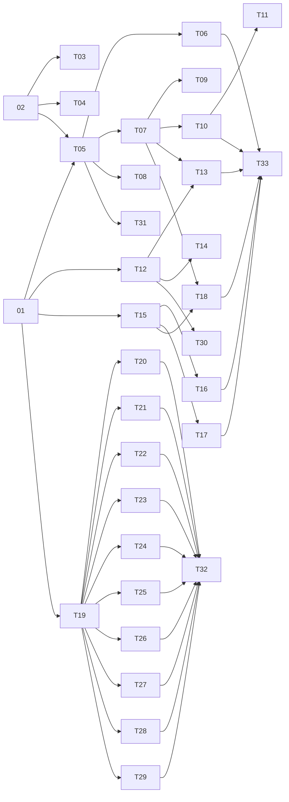

# Tickets publiés — Bibliothèque universelle de recettes

Source : [spécification de la bibliothèque universelle](universal-recipe-library.md), glossaire et ADR sur la bibliothèque et la licence du catalogue.

Les 33 tickets sont publiés sur GitHub et rattachés à la [spécification #4](https://github.com/maurice30120/mcp-leclerc-drive/issues/4). Chacun porte le label `ready-for-agent` ; les 48 dépendances sont enregistrées comme relations de blocage natives.

## Organisation du travail en parallèle

Les tickets 01 et 02 peuvent démarrer immédiatement. Ils livrent deux parcours observables : consulter une recette témoin via MCP et capturer une page dans le stockage local. Une fois les contrats publics fixés par ces parcours, les branches de recherche, calcul, catalogue et structuration peuvent avancer séparément.

Chaque ticket apporte son comportement et ses tests au même niveau public ; les tests ne constituent pas une chaîne de tickets distincte. Les scénarios utilisent des fixtures et des sorties de modèle simulées. Le scénario de courses 33 peut être intégré avant la fin du catalogue complet.

Les relations ci-dessous indiquent uniquement les blocages nécessaires. Elles ne répètent pas les dépendances transitives. Les vagues sont une lecture indicative si tous les tickets d’une vague terminaient ensemble ; dans la pratique, tout ticket démarre dès que ses propres bloqueurs sont terminés.

- Vague 1 : 01, 02.
- Vague 2 : 03, 04, 05, 12, 15, 19.
- Vague 3 : 06, 07, 08, 14, 16, 17, 20, 21, 22, 23, 24, 25, 26, 27, 28, 29, 30, 31.
- Vague 4 : 09, 10, 13, 18, 32.
- Vague 5 : 11, 33.

La plus grande vague contient 18 tickets indépendants. Le nombre d’agents disponibles peut naturellement être plus faible.

Pour réduire les conflits de fusion : les tickets initiaux fixent les points d’extension et les contrats ; chaque nouvelle capacité enregistre ses propres handlers et ses scénarios ; les entrées communes restent des points de câblage limités. Le pipeline du catalogue prépare dix partitions disjointes et des sorties de lots séparées avant leur traitement parallèle. Les deux tickets initiaux portent des données différentes, captures brutes pour 02 et recettes structurées pour 01, et ne partagent pas de dépendance d’implémentation.

Aucun refactoring large préalable n’est imposé : le point d’extension minimal nécessaire est livré avec la première capacité consultable. Les dix lots de contenu sont des livraisons utilisables et vérifiables séparément, avec leurs notices et leur exposition dans le catalogue construit. Un lot vise 50 recettes, taille choisie pour qu’un agent puisse traiter validation et provenance dans une session de travail.

## Vue d’ensemble

| Ticket | Titre | Bloqué par | Comportement livré |
| --- | --- | --- | --- |
| 01 | [Consulter une première recette intégrée par MCP](https://github.com/maurice30120/mcp-leclerc-drive/issues/5) | Aucun | Un client MCP consulte une recette témoin complète et sa provenance, sans service externe. |
| 02 | [Capturer une page visible dans la bibliothèque locale en attente](https://github.com/maurice30120/mcp-leclerc-drive/issues/6) | Aucun | Depuis une page de cuisine, l’utilisateur clique dans l’extension et conserve son URL et un extrait utile pour une structuration ultérieure. |
| 03 | [Capturer les données structurées de recettes des sites compatibles](https://github.com/maurice30120/mcp-leclerc-drive/issues/7) | 02 | Une page contenant des données Recipe structurées fournit au modèle un extrait plus précis que le seul texte visible. |
| 04 | [Éviter les captures répétées de la même page](https://github.com/maurice30120/mcp-leclerc-drive/issues/8) | 02 | Cliquer plusieurs fois sur la même page ne remplit pas la file de captures avec des doublons. |
| 05 | [Signaler les captures en attente lors des appels MCP](https://github.com/maurice30120/mcp-leclerc-drive/issues/9) | 01, 02 | Le prochain appel MCP permet à l’agent de découvrir les pages sauvegardées dans l’extension. |
| 06 | [Lire l’extrait d’une capture depuis le client MCP](https://github.com/maurice30120/mcp-leclerc-drive/issues/10) | 05 | L’agent récupère les données nécessaires pour structurer une page découverte dans les captures en attente. |
| 07 | [Enregistrer une recette personnelle complète par MCP](https://github.com/maurice30120/mcp-leclerc-drive/issues/11) | 05 | À partir d’une capture, le modèle du client soumet une recette complète qui devient consultable dans sa bibliothèque locale. |
| 08 | [Abandonner une capture impossible à structurer](https://github.com/maurice30120/mcp-leclerc-drive/issues/12) | 05 | L’agent supprime une capture inexploitable sans créer de recette ni laisser de fiche partielle. |
| 09 | [Rejouer une sauvegarde personnelle sans créer de doublons](https://github.com/maurice30120/mcp-leclerc-drive/issues/13) | 07 | Une nouvelle tentative ou deux agents sur la même capture ne créent qu’une seule recette personnelle. |
| 10 | [Annoncer une fois les nouvelles recettes personnelles](https://github.com/maurice30120/mcp-leclerc-drive/issues/14) | 07 | Une recette structurée est signalée une seule fois par MCP puis reste accessible dans la bibliothèque. |
| 11 | [Garder un digest unique avec plusieurs appels ou onglets MCP](https://github.com/maurice30120/mcp-leclerc-drive/issues/15) | 10 | Plusieurs clients ou onglets actifs ne reçoivent pas chacun les mêmes nouveautés. |
| 12 | [Rechercher les recettes du catalogue intégré](https://github.com/maurice30120/mcp-leclerc-drive/issues/16) | 01 | L’agent découvre des recettes intégrées par leur titre puis peut ouvrir celle qu’il choisit. |
| 13 | [Rechercher ensemble les recettes intégrées et personnelles](https://github.com/maurice30120/mcp-leclerc-drive/issues/17) | 07, 12 | Une même recherche permet à l’agent de choisir dans les deux collections et d’en distinguer l’origine. |
| 14 | [Parcourir les résultats de recherche sur plusieurs pages](https://github.com/maurice30120/mcp-leclerc-drive/issues/18) | 12 | L’agent peut explorer une collection importante sans perdre les résultats au-delà de la première réponse. |
| 15 | [Calculer les ingrédients d’une recette pour les portions choisies](https://github.com/maurice30120/mcp-leclerc-drive/issues/19) | 01 | L’agent demande une recette et un nombre de portions et reçoit les quantités recalculées de manière déterministe. |
| 16 | [Regrouper les ingrédients de plusieurs recettes](https://github.com/maurice30120/mcp-leclerc-drive/issues/20) | 15 | Plusieurs recettes et portions produisent une liste consolidée avec l’origine de chaque quantité. |
| 17 | [Appliquer une adaptation légère uniquement au calcul demandé](https://github.com/maurice30120/mcp-leclerc-drive/issues/21) | 15 | L’agent ajuste un ingrédient pour une commande tout en conservant la recette de référence. |
| 18 | [Calculer les ingrédients des recettes personnelles avec le même outil](https://github.com/maurice30120/mcp-leclerc-drive/issues/22) | 07, 15 | L’agent utilise ses recettes sauvegardées dans le calculateur exactement comme celles du catalogue. |
| 19 | [Livrer un premier lot Wikilivres reproductible et attribué](https://github.com/maurice30120/mcp-leclerc-drive/issues/23) | 01 | Un premier petit lot de vraies recettes Wikilivres est distribué et consultable dans l’extension avec ses attributions. |
| 20 | [Ajouter le lot A du catalogue français](https://github.com/maurice30120/mcp-leclerc-drive/issues/24) | 19 | Un lot indépendant visant environ 50 recettes valides devient consultable par les outils MCP. |
| 21 | [Ajouter le lot B du catalogue français](https://github.com/maurice30120/mcp-leclerc-drive/issues/25) | 19 | Un lot indépendant visant environ 50 recettes valides devient consultable par les outils MCP. |
| 22 | [Ajouter le lot C du catalogue français](https://github.com/maurice30120/mcp-leclerc-drive/issues/26) | 19 | Un lot indépendant visant environ 50 recettes valides devient consultable par les outils MCP. |
| 23 | [Ajouter le lot D du catalogue français](https://github.com/maurice30120/mcp-leclerc-drive/issues/27) | 19 | Un lot indépendant visant environ 50 recettes valides devient consultable par les outils MCP. |
| 24 | [Ajouter le lot E du catalogue français](https://github.com/maurice30120/mcp-leclerc-drive/issues/28) | 19 | Un lot indépendant visant environ 50 recettes valides devient consultable par les outils MCP. |
| 25 | [Ajouter le lot F du catalogue français](https://github.com/maurice30120/mcp-leclerc-drive/issues/29) | 19 | Un lot indépendant visant environ 50 recettes valides devient consultable par les outils MCP. |
| 26 | [Ajouter le lot G du catalogue français](https://github.com/maurice30120/mcp-leclerc-drive/issues/30) | 19 | Un lot indépendant visant environ 50 recettes valides devient consultable par les outils MCP. |
| 27 | [Ajouter le lot H du catalogue français](https://github.com/maurice30120/mcp-leclerc-drive/issues/31) | 19 | Un lot indépendant visant environ 50 recettes valides devient consultable par les outils MCP. |
| 28 | [Ajouter le lot I du catalogue français](https://github.com/maurice30120/mcp-leclerc-drive/issues/32) | 19 | Un lot indépendant visant environ 50 recettes valides devient consultable par les outils MCP. |
| 29 | [Ajouter le lot J du catalogue français](https://github.com/maurice30120/mcp-leclerc-drive/issues/33) | 19 | Un lot indépendant visant environ 50 recettes valides devient consultable par les outils MCP. |
| 30 | [Trouver une recette par ingrédient ou catégorie](https://github.com/maurice30120/mcp-leclerc-drive/issues/34) | 12 | L’agent trouve aussi une recette lorsque le terme recherché figure dans ses ingrédients ou sa catégorie. |
| 31 | [Reprendre les opérations recettes après interruption du navigateur](https://github.com/maurice30120/mcp-leclerc-drive/issues/35) | 05 | Après mise en veille du service worker ou navigation d’un onglet, l’utilisateur peut reprendre ses opérations de recettes. |
| 32 | [Installer le catalogue complet avec ses notices et sans service culinaire](https://github.com/maurice30120/mcp-leclerc-drive/issues/36) | 20, 21, 22, 23, 24, 25, 26, 27, 28, 29 | Une installation neuve propose le catalogue assemblé, visant environ 500 recettes, avec ses attributions accessibles. |
| 33 | [Préparer les courses avec des recettes via un client MCP portable](https://github.com/maurice30120/mcp-leclerc-drive/issues/37) | 06, 10, 13, 16, 17, 18 | Un agent découvre et structure une recette sauvegardée, la combine au catalogue puis poursuit les achats avec les outils Leclerc habituels. |

## Graphe des dépendances

## Tickets détaillés

## 01 — Consulter une première recette intégrée par MCP

**GitHub:** [#5](https://github.com/maurice30120/mcp-leclerc-drive/issues/5).

**What to build:** Un client MCP consulte une recette témoin complète et sa provenance, sans service externe.

**Blocked by:** None (can start immediately).

**Status:** ready-for-agent.

- [ ] Une petite collection témoin distribuée avec l’extension est consultable par identifiant depuis un outil MCP réellement enregistré.
- [ ] Le contrat commun versionné fixe identifiant non ambigu, titre, portions positives, ingrédients quantifiés avec nom normalisé et unité, étapes et provenance ; catégorie et temps restent facultatifs.
- [ ] Un identifiant inconnu ou une donnée invalide produit une erreur exploitable, sans recette partielle ni invention de quantité.
- [ ] La fonctionnalité possède un point d’entrée d’enregistrement composable et un harnais de tests au niveau des contrats MCP ; les outils Leclerc existants gardent leur comportement.
- [ ] Les interfaces utiles aux autres tickets sont décrites explicitement : consultation du catalogue, enregistrement de capacités et structure de recette. Aucun travail de capture ou de modèle local n’est requis.

## 02 — Capturer une page visible dans la bibliothèque locale en attente

**GitHub:** [#6](https://github.com/maurice30120/mcp-leclerc-drive/issues/6).

**What to build:** Depuis une page de cuisine, l’utilisateur clique dans l’extension et conserve son URL et un extrait utile pour une structuration ultérieure.

**Blocked by:** None (can start immediately).

**Status:** ready-for-agent.

- [ ] L’action explicite de sauvegarde fonctionne sur l’onglet actif non Leclerc avec l’accès temporaire déjà disponible.
- [ ] Un enregistrement de capture possède un identifiant stable, l’URL source, la date et un extrait borné ; son état reste distinct d’une recette validée.
- [ ] Le contenu visible utile est conservé sans page HTML entière, scripts, champs de formulaire ou exécution de contenu externe ; l’absence de contenu exploitable ou un accès interdit produit un message clair.
- [ ] La capture survit à la fermeture du popup et à la relance du service worker ou du navigateur ; un échec de stockage n’est jamais présenté comme une réussite.
- [ ] Le stockage expose des opérations limitées aux captures pour que les tickets suivants puissent les lister, consulter et terminer sans modifier le contrôleur du popup.

## 03 — Capturer les données structurées de recettes des sites compatibles

**GitHub:** [#7](https://github.com/maurice30120/mcp-leclerc-drive/issues/7).

**What to build:** Une page contenant des données Recipe structurées fournit au modèle un extrait plus précis que le seul texte visible.

**Blocked by:** 02 — Capturer une page visible dans la bibliothèque locale en attente.

**Status:** ready-for-agent.

- [ ] Les données structurées pertinentes de type Recipe alimentent l’extrait utile tout en conservant URL et provenance de la capture.
- [ ] Des blocs multiples ou imbriqués et un bloc malformé ne font pas perdre le contenu visible exploitable.
- [ ] Le résultat reste une capture en attente : aucun appel de modèle ni enregistrement automatique d’une recette complète n’est ajouté.
- [ ] Des fixtures de plusieurs structures de pages démontrent le fonctionnement, les limites de taille et le traitement du contenu non fiable.

## 04 — Éviter les captures répétées de la même page

**GitHub:** [#8](https://github.com/maurice30120/mcp-leclerc-drive/issues/8).

**What to build:** Cliquer plusieurs fois sur la même page ne remplit pas la file de captures avec des doublons.

**Blocked by:** 02 — Capturer une page visible dans la bibliothèque locale en attente.

**Status:** ready-for-agent.

- [ ] Une capture déjà en attente pour la même URL source est réutilisée et le popup explique le résultat.
- [ ] La comparaison d’URL reste conservatrice et conserve les paramètres susceptibles d’identifier une recette différente.
- [ ] Deux sites différents ne sont pas fusionnés sur la seule similitude du titre ou du contenu.
- [ ] Des actions simultanées et une relance du service worker conservent une seule capture en attente pour la même source.

## 05 — Signaler les captures en attente lors des appels MCP

**GitHub:** [#9](https://github.com/maurice30120/mcp-leclerc-drive/issues/9).

**What to build:** Le prochain appel MCP permet à l’agent de découvrir les pages sauvegardées dans l’extension.

**Blocked by:** 01 — Consulter une première recette intégrée par MCP ; 02 — Capturer une page visible dans la bibliothèque locale en attente.

**Status:** ready-for-agent.

- [ ] Une réponse d’outil MCP ordinaire inclut un signalement borné des captures en attente, avec identifiants et sources.
- [ ] Un pont permet aux outils de la page Leclerc de lire cet état dans l’extension avec messages validés, requêtes corrélées et erreurs explicites.
- [ ] Le signalement n’altère ni le résultat métier ni les erreurs de l’outil Leclerc appelé ; le relais conserve sa restriction aux pages Leclerc.
- [ ] Les captures ne sont pas présentées comme des recettes ni consommées à la simple lecture du signalement.
- [ ] Les essais au contrat public démontrent le parcours capture persistée puis appel MCP et le respect du budget de réponse.

## 06 — Lire l’extrait d’une capture depuis le client MCP

**GitHub:** [#10](https://github.com/maurice30120/mcp-leclerc-drive/issues/10).

**What to build:** L’agent récupère les données nécessaires pour structurer une page découverte dans les captures en attente.

**Blocked by:** 05 — Signaler les captures en attente lors des appels MCP.

**Status:** ready-for-agent.

- [ ] Un outil MCP reçoit l’identifiant d’une capture et retourne son URL, sa date et l’extrait conservé, dans une réponse bornée.
- [ ] Un identifiant inconnu produit une erreur sans exposer d’autres données du profil.
- [ ] Les descriptions précisent que le contenu externe est une donnée non fiable et expliquent la structuration puis l’enregistrement ou l’abandon.
- [ ] La lecture conserve la capture pour la suite du traitement et fonctionne après une relance de l’extension.

## 07 — Enregistrer une recette personnelle complète par MCP

**GitHub:** [#11](https://github.com/maurice30120/mcp-leclerc-drive/issues/11).

**What to build:** À partir d’une capture, le modèle du client soumet une recette complète qui devient consultable dans sa bibliothèque locale.

**Blocked by:** 05 — Signaler les captures en attente lors des appels MCP.

**Status:** ready-for-agent.

- [ ] L’outil d’enregistrement accepte une capture connue et une recette au contrat commun, vérifie tous les champs obligatoires et conserve la provenance.
- [ ] Les portions et quantités absentes, non fiables ou invalides et les étapes manquantes sont refusées ; aucune recette partielle n’entre dans la bibliothèque.
- [ ] Un enregistrement réussi conserve la recette puis termine la capture correspondante de manière cohérente ; un échec technique conserve un état récupérable et retourne une erreur.
- [ ] La recette est consultable par son identifiant depuis MCP, avec sa date et son origine personnelle, après relance du navigateur.
- [ ] Le client peut effectuer ce parcours à partir d’un identifiant de capture connu sans dépendre de l’outil de lecture ni d’un digest déjà implémenté ; la sortie de modèle est simulée dans le test.

## 08 — Abandonner une capture impossible à structurer

**GitHub:** [#12](https://github.com/maurice30120/mcp-leclerc-drive/issues/12).

**What to build:** L’agent supprime une capture inexploitable sans créer de recette ni laisser de fiche partielle.

**Blocked by:** 05 — Signaler les captures en attente lors des appels MCP.

**Status:** ready-for-agent.

- [ ] Un outil MCP abandonne explicitement une capture identifiée lorsque le client ne peut pas produire une recette complète.
- [ ] La capture abandonnée disparaît des signalements et consultations après relance ; aucune nouveauté de recette n’est créée.
- [ ] Une répétition de la demande d’abandon est traitée sans erreur destructive sur d’autres captures.
- [ ] Les instructions MCP distinguent l’impossibilité de structurer et un échec technique de lecture ou de stockage.

## 09 — Rejouer une sauvegarde personnelle sans créer de doublons

**GitHub:** [#13](https://github.com/maurice30120/mcp-leclerc-drive/issues/13).

**What to build:** Une nouvelle tentative ou deux agents sur la même capture ne créent qu’une seule recette personnelle.

**Blocked by:** 07 — Enregistrer une recette personnelle complète par MCP.

**Status:** ready-for-agent.

- [ ] Le rejeu d’une sauvegarde déjà réussie renvoie la recette existante plutôt que de créer un second identifiant.
- [ ] Deux sauvegardes concurrentes de la même capture aboutissent à une seule recette et un état de finalisation cohérent.
- [ ] Une nouvelle capture de la même source déjà enregistrée ne crée pas silencieusement une copie ni un événement de nouveauté supplémentaire.
- [ ] Le contrat d’idempotence reste valable après interruption et relance ; aucune recette de source différente n’est fusionnée par similarité.

## 10 — Annoncer une fois les nouvelles recettes personnelles

**GitHub:** [#14](https://github.com/maurice30120/mcp-leclerc-drive/issues/14).

**What to build:** Une recette structurée est signalée une seule fois par MCP puis reste accessible dans la bibliothèque.

**Blocked by:** 07 — Enregistrer une recette personnelle complète par MCP.

**Status:** ready-for-agent.

- [ ] Après l’enregistrement réussi, un digest inclut identifiant, titre et portions des nouvelles recettes personnelles.
- [ ] Les appels suivants ne répètent pas les recettes déjà signalées ; l’état de diffusion est persistant.
- [ ] Le catalogue intégré et les captures non structurées sont exclus des nouveautés.
- [ ] Les lots annoncés restent bornés ; seules les recettes effectivement incluses dans la réponse sont marquées comme signalées, les suivantes restent en attente.
- [ ] Le parcours séquentiel enregistrement, notification, relance et consultation ultérieure est vérifié aux contrats publics.

## 11 — Garder un digest unique avec plusieurs appels ou onglets MCP

**GitHub:** [#15](https://github.com/maurice30120/mcp-leclerc-drive/issues/15).

**What to build:** Plusieurs clients ou onglets actifs ne reçoivent pas chacun les mêmes nouveautés.

**Blocked by:** 10 — Annoncer une fois les nouvelles recettes personnelles.

**Status:** ready-for-agent.

- [ ] La sélection et la consommation d’un lot de nouveautés évitent les doubles annonces lors d’appels concurrents.
- [ ] Un lot trop volumineux est réparti sur plusieurs appels sans perdre les recettes non annoncées.
- [ ] Une interruption du service worker n’altère ni les recettes enregistrées ni la file persistante de nouveautés.
- [ ] Les tests décrivent la limite de livraison MCP : une réponse émise ne prouve pas qu’elle a été lue ; aucune garantie de lecture n’est inventée.

## 12 — Rechercher les recettes du catalogue intégré

**GitHub:** [#16](https://github.com/maurice30120/mcp-leclerc-drive/issues/16).

**What to build:** L’agent découvre des recettes intégrées par leur titre puis peut ouvrir celle qu’il choisit.

**Blocked by:** 01 — Consulter une première recette intégrée par MCP.

**Status:** ready-for-agent.

- [ ] Un outil MCP recherche les titres du catalogue et retourne des résultats compacts avec identifiant, titre, portions et origine.
- [ ] Le résultat distingue une absence de correspondance d’une erreur et impose une limite explicite sans réponse excessivement grande.
- [ ] La recherche respecte les accents et les mots culinaires sans introduire de rapprochement sémantique automatique.
- [ ] Un résultat retourné peut être consulté entièrement avec l’outil de lecture existant, sans serveur ni modèle local.

## 13 — Rechercher ensemble les recettes intégrées et personnelles

**GitHub:** [#17](https://github.com/maurice30120/mcp-leclerc-drive/issues/17).

**What to build:** Une même recherche permet à l’agent de choisir dans les deux collections et d’en distinguer l’origine.

**Blocked by:** 07 — Enregistrer une recette personnelle complète par MCP ; 12 — Rechercher les recettes du catalogue intégré.

**Status:** ready-for-agent.

- [ ] La recherche inclut les recettes personnelles persistées et les recettes intégrées dans le même format de résultat.
- [ ] Un filtre d’origine permet de limiter la recherche au catalogue ou à la bibliothèque personnelle.
- [ ] Les identifiants des deux collections ne se heurtent pas et tous les résultats sont consultables par le même contrat.
- [ ] Les captures en attente ou abandonnées restent absentes et les données personnelles ne sont jamais copiées dans le catalogue distribué.

## 14 — Parcourir les résultats de recherche sur plusieurs pages

**GitHub:** [#18](https://github.com/maurice30120/mcp-leclerc-drive/issues/18).

**What to build:** L’agent peut explorer une collection importante sans perdre les résultats au-delà de la première réponse.

**Blocked by:** 12 — Rechercher les recettes du catalogue intégré.

**Status:** ready-for-agent.

- [ ] La recherche retourne un moyen explicite d’obtenir la page suivante avec un ordre stable.
- [ ] La pagination conserve les critères et le filtre d’origine sans duplication ou omission sur un jeu de données inchangé.
- [ ] Les limites et références de pagination invalides produisent une erreur exploitable.
- [ ] Chaque page respecte le budget de transport ; le comportement est vérifiable avec le seul catalogue intégré et réutilisable par la recherche unifiée.

## 15 — Calculer les ingrédients d’une recette pour les portions choisies

**GitHub:** [#19](https://github.com/maurice30120/mcp-leclerc-drive/issues/19).

**What to build:** L’agent demande une recette et un nombre de portions et reçoit les quantités recalculées de manière déterministe.

**Blocked by:** 01 — Consulter une première recette intégrée par MCP.

**Status:** ready-for-agent.

- [ ] Un outil MCP reçoit une recette intégrée choisie et des portions cibles positives ; il retourne les quantités selon le rapport avec les portions de référence.
- [ ] Les quantités décimales sont stables et restent culinaires : aucun arrondi en paquets ou conversion d’unité n’est appliqué.
- [ ] Le résultat expose la recette, les portions de référence, les portions cibles et les quantités calculées.
- [ ] La recette consultable reste intacte ; les entrées invalides sont refusées avant tout calcul.
- [ ] Le contrat prévoit explicitement la sélection de plusieurs recettes et les adaptations temporaires pour permettre leurs extensions indépendantes.

## 16 — Regrouper les ingrédients de plusieurs recettes

**GitHub:** [#20](https://github.com/maurice30120/mcp-leclerc-drive/issues/20).

**What to build:** Plusieurs recettes et portions produisent une liste consolidée avec l’origine de chaque quantité.

**Blocked by:** 15 — Calculer les ingrédients d’une recette pour les portions choisies.

**Status:** ready-for-agent.

- [ ] Un seul appel accepte plusieurs sélections de recettes et calcule leurs quantités respectives.
- [ ] Seules les lignes au même nom normalisé et à la même unité sont additionnées ; ingrédients différents et unités différentes restent séparés.
- [ ] La normalisation reste superficielle et déterministe, sans synonymes, suppression ambiguë d’accents ni conversion d’unité.
- [ ] Chaque total est accompagné des contributions identifiées de chaque recette ; les cas de fractions et décimales sont vérifiés.
- [ ] Le résultat n’effectue aucune mutation de panier ni déduction sur les produits commerciaux.

## 17 — Appliquer une adaptation légère uniquement au calcul demandé

**GitHub:** [#21](https://github.com/maurice30120/mcp-leclerc-drive/issues/21).

**What to build:** L’agent ajuste un ingrédient pour une commande tout en conservant la recette de référence.

**Blocked by:** 15 — Calculer les ingrédients d’une recette pour les portions choisies.

**Status:** ready-for-agent.

- [ ] L’appel de calcul accepte des adaptations explicites avec des quantités exprimées pour les portions de référence, puis applique le facteur de portions.
- [ ] Les substitutions et modifications sont visibles dans le résultat et restent rattachées à la recette d’origine.
- [ ] La consultation suivante retourne la recette enregistrée intacte ; aucune variante n’est sauvegardée automatiquement.
- [ ] Les instructions MCP autorisent les ajustements de portions et substitutions proches, et réservent les transformations importantes à une instruction de l’utilisateur.
- [ ] Les tests vérifient les effets observables des adaptations et des entrées invalides sans prétendre automatiser le jugement culinaire.

## 18 — Calculer les ingrédients des recettes personnelles avec le même outil

**GitHub:** [#22](https://github.com/maurice30120/mcp-leclerc-drive/issues/22).

**What to build:** L’agent utilise ses recettes sauvegardées dans le calculateur exactement comme celles du catalogue.

**Blocked by:** 07 — Enregistrer une recette personnelle complète par MCP ; 15 — Calculer les ingrédients d’une recette pour les portions choisies.

**Status:** ready-for-agent.

- [ ] Le calculateur résout les identifiants personnels avec les mêmes validations, unités, portions et sorties que les identifiants intégrés.
- [ ] Une recette personnelle reste utilisable après relance et après sa notification par digest.
- [ ] Le détail conserve la provenance et l’identité de la recette personnelle.
- [ ] L’extension du résolveur fonctionne aussi pour les appels multiples ou adaptés, dès que ces capacités sont présentes, sans dupliquer leur logique.

## 19 — Livrer un premier lot Wikilivres reproductible et attribué

**GitHub:** [#23](https://github.com/maurice30120/mcp-leclerc-drive/issues/23).

**What to build:** Un premier petit lot de vraies recettes Wikilivres est distribué et consultable dans l’extension avec ses attributions.

**Blocked by:** 01 — Consulter une première recette intégrée par MCP.

**Status:** ready-for-agent.

- [ ] Une préparation reproductible à partir de sources archivées produit un lot pilote de recettes complètes au contrat commun, consultables par MCP dans l’extension construite.
- [ ] Chaque recette conserve URL, attribution, licence du contenu et indications des modifications ; les notices du catalogue suivent l’ADR de licence séparée du code.
- [ ] Les sources incomplètes sont exclues avec un rapport explicite ; aucune quantité ou portion n’est fabriquée pour atteindre un nombre cible.
- [ ] Le pipeline fournit un manifeste stable de sources dédupliquées et dix partitions disjointes pour les lots parallèles suivants.
- [ ] Les lots peuvent être construits séparément puis assemblés sans modifier chacun un même fichier central ; chaque lot réutilise la validation commune et des fixtures locales.

## 20 — Ajouter le lot A du catalogue français

**GitHub:** [#24](https://github.com/maurice30120/mcp-leclerc-drive/issues/24).

**What to build:** Un lot indépendant visant environ 50 recettes valides devient consultable par les outils MCP.

**Blocked by:** 19 — Livrer un premier lot Wikilivres reproductible et attribué.

**Status:** ready-for-agent.

- [ ] Traiter uniquement la partition A du manifeste stable et produire son lot complet de recettes, notices et provenance.
- [ ] Chaque recette retenue respecte le contrat partagé et est consultable dans une construction incluant ce lot.
- [ ] Le lot ne duplique aucune source du pilote ou des autres partitions ; les exclusions et le nombre obtenu sont documentés.
- [ ] Le lot se vérifie indépendamment avec ses fixtures et ses propres sorties, sans attendre les neuf autres lots ni inventer de données pour atteindre le quota.

## 21 — Ajouter le lot B du catalogue français

**GitHub:** [#25](https://github.com/maurice30120/mcp-leclerc-drive/issues/25).

**What to build:** Un lot indépendant visant environ 50 recettes valides devient consultable par les outils MCP.

**Blocked by:** 19 — Livrer un premier lot Wikilivres reproductible et attribué.

**Status:** ready-for-agent.

- [ ] Traiter uniquement la partition B du manifeste stable et produire son lot complet de recettes, notices et provenance.
- [ ] Chaque recette retenue respecte le contrat partagé et est consultable dans une construction incluant ce lot.
- [ ] Le lot ne duplique aucune source du pilote ou des autres partitions ; les exclusions et le nombre obtenu sont documentés.
- [ ] Le lot se vérifie indépendamment avec ses fixtures et ses propres sorties, sans attendre les neuf autres lots ni inventer de données pour atteindre le quota.

## 22 — Ajouter le lot C du catalogue français

**GitHub:** [#26](https://github.com/maurice30120/mcp-leclerc-drive/issues/26).

**What to build:** Un lot indépendant visant environ 50 recettes valides devient consultable par les outils MCP.

**Blocked by:** 19 — Livrer un premier lot Wikilivres reproductible et attribué.

**Status:** ready-for-agent.

- [ ] Traiter uniquement la partition C du manifeste stable et produire son lot complet de recettes, notices et provenance.
- [ ] Chaque recette retenue respecte le contrat partagé et est consultable dans une construction incluant ce lot.
- [ ] Le lot ne duplique aucune source du pilote ou des autres partitions ; les exclusions et le nombre obtenu sont documentés.
- [ ] Le lot se vérifie indépendamment avec ses fixtures et ses propres sorties, sans attendre les neuf autres lots ni inventer de données pour atteindre le quota.

## 23 — Ajouter le lot D du catalogue français

**GitHub:** [#27](https://github.com/maurice30120/mcp-leclerc-drive/issues/27).

**What to build:** Un lot indépendant visant environ 50 recettes valides devient consultable par les outils MCP.

**Blocked by:** 19 — Livrer un premier lot Wikilivres reproductible et attribué.

**Status:** ready-for-agent.

- [ ] Traiter uniquement la partition D du manifeste stable et produire son lot complet de recettes, notices et provenance.
- [ ] Chaque recette retenue respecte le contrat partagé et est consultable dans une construction incluant ce lot.
- [ ] Le lot ne duplique aucune source du pilote ou des autres partitions ; les exclusions et le nombre obtenu sont documentés.
- [ ] Le lot se vérifie indépendamment avec ses fixtures et ses propres sorties, sans attendre les neuf autres lots ni inventer de données pour atteindre le quota.

## 24 — Ajouter le lot E du catalogue français

**GitHub:** [#28](https://github.com/maurice30120/mcp-leclerc-drive/issues/28).

**What to build:** Un lot indépendant visant environ 50 recettes valides devient consultable par les outils MCP.

**Blocked by:** 19 — Livrer un premier lot Wikilivres reproductible et attribué.

**Status:** ready-for-agent.

- [ ] Traiter uniquement la partition E du manifeste stable et produire son lot complet de recettes, notices et provenance.
- [ ] Chaque recette retenue respecte le contrat partagé et est consultable dans une construction incluant ce lot.
- [ ] Le lot ne duplique aucune source du pilote ou des autres partitions ; les exclusions et le nombre obtenu sont documentés.
- [ ] Le lot se vérifie indépendamment avec ses fixtures et ses propres sorties, sans attendre les neuf autres lots ni inventer de données pour atteindre le quota.

## 25 — Ajouter le lot F du catalogue français

**GitHub:** [#29](https://github.com/maurice30120/mcp-leclerc-drive/issues/29).

**What to build:** Un lot indépendant visant environ 50 recettes valides devient consultable par les outils MCP.

**Blocked by:** 19 — Livrer un premier lot Wikilivres reproductible et attribué.

**Status:** ready-for-agent.

- [ ] Traiter uniquement la partition F du manifeste stable et produire son lot complet de recettes, notices et provenance.
- [ ] Chaque recette retenue respecte le contrat partagé et est consultable dans une construction incluant ce lot.
- [ ] Le lot ne duplique aucune source du pilote ou des autres partitions ; les exclusions et le nombre obtenu sont documentés.
- [ ] Le lot se vérifie indépendamment avec ses fixtures et ses propres sorties, sans attendre les neuf autres lots ni inventer de données pour atteindre le quota.

## 26 — Ajouter le lot G du catalogue français

**GitHub:** [#30](https://github.com/maurice30120/mcp-leclerc-drive/issues/30).

**What to build:** Un lot indépendant visant environ 50 recettes valides devient consultable par les outils MCP.

**Blocked by:** 19 — Livrer un premier lot Wikilivres reproductible et attribué.

**Status:** ready-for-agent.

- [ ] Traiter uniquement la partition G du manifeste stable et produire son lot complet de recettes, notices et provenance.
- [ ] Chaque recette retenue respecte le contrat partagé et est consultable dans une construction incluant ce lot.
- [ ] Le lot ne duplique aucune source du pilote ou des autres partitions ; les exclusions et le nombre obtenu sont documentés.
- [ ] Le lot se vérifie indépendamment avec ses fixtures et ses propres sorties, sans attendre les neuf autres lots ni inventer de données pour atteindre le quota.

## 27 — Ajouter le lot H du catalogue français

**GitHub:** [#31](https://github.com/maurice30120/mcp-leclerc-drive/issues/31).

**What to build:** Un lot indépendant visant environ 50 recettes valides devient consultable par les outils MCP.

**Blocked by:** 19 — Livrer un premier lot Wikilivres reproductible et attribué.

**Status:** ready-for-agent.

- [ ] Traiter uniquement la partition H du manifeste stable et produire son lot complet de recettes, notices et provenance.
- [ ] Chaque recette retenue respecte le contrat partagé et est consultable dans une construction incluant ce lot.
- [ ] Le lot ne duplique aucune source du pilote ou des autres partitions ; les exclusions et le nombre obtenu sont documentés.
- [ ] Le lot se vérifie indépendamment avec ses fixtures et ses propres sorties, sans attendre les neuf autres lots ni inventer de données pour atteindre le quota.

## 28 — Ajouter le lot I du catalogue français

**GitHub:** [#32](https://github.com/maurice30120/mcp-leclerc-drive/issues/32).

**What to build:** Un lot indépendant visant environ 50 recettes valides devient consultable par les outils MCP.

**Blocked by:** 19 — Livrer un premier lot Wikilivres reproductible et attribué.

**Status:** ready-for-agent.

- [ ] Traiter uniquement la partition I du manifeste stable et produire son lot complet de recettes, notices et provenance.
- [ ] Chaque recette retenue respecte le contrat partagé et est consultable dans une construction incluant ce lot.
- [ ] Le lot ne duplique aucune source du pilote ou des autres partitions ; les exclusions et le nombre obtenu sont documentés.
- [ ] Le lot se vérifie indépendamment avec ses fixtures et ses propres sorties, sans attendre les neuf autres lots ni inventer de données pour atteindre le quota.

## 29 — Ajouter le lot J du catalogue français

**GitHub:** [#33](https://github.com/maurice30120/mcp-leclerc-drive/issues/33).

**What to build:** Un lot indépendant visant environ 50 recettes valides devient consultable par les outils MCP.

**Blocked by:** 19 — Livrer un premier lot Wikilivres reproductible et attribué.

**Status:** ready-for-agent.

- [ ] Traiter uniquement la partition J du manifeste stable et produire son lot complet de recettes, notices et provenance.
- [ ] Chaque recette retenue respecte le contrat partagé et est consultable dans une construction incluant ce lot.
- [ ] Le lot ne duplique aucune source du pilote ou des autres partitions ; les exclusions et le nombre obtenu sont documentés.
- [ ] Le lot se vérifie indépendamment avec ses fixtures et ses propres sorties, sans attendre les neuf autres lots ni inventer de données pour atteindre le quota.

## 30 — Trouver une recette par ingrédient ou catégorie

**GitHub:** [#34](https://github.com/maurice30120/mcp-leclerc-drive/issues/34).

**What to build:** L’agent trouve aussi une recette lorsque le terme recherché figure dans ses ingrédients ou sa catégorie.

**Blocked by:** 12 — Rechercher les recettes du catalogue intégré.

**Status:** ready-for-agent.

- [ ] Le contrat de recherche permet de cibler les ingrédients normalisés et les catégories renseignées, avec des résultats compacts et consultables.
- [ ] Les recettes sans catégorie ou temps facultatif restent valides et trouvables selon les autres critères.
- [ ] La recherche ne déduit pas de synonymes culinaires ni d’équivalences d’ingrédients.
- [ ] Le comportement fonctionne sur le catalogue seul et s’applique aux recettes personnelles lorsque la recherche unifiée est disponible, sans dépendance artificielle à cette branche.

## 31 — Reprendre les opérations recettes après interruption du navigateur

**GitHub:** [#35](https://github.com/maurice30120/mcp-leclerc-drive/issues/35).

**What to build:** Après mise en veille du service worker ou navigation d’un onglet, l’utilisateur peut reprendre ses opérations de recettes.

**Blocked by:** 05 — Signaler les captures en attente lors des appels MCP.

**Status:** ready-for-agent.

- [ ] Une demande interrompue se termine par une erreur bornée dans le temps et ne reçoit pas la réponse d’une autre demande.
- [ ] Un appel suivant rétablit l’accès au stockage et aux captures persistantes sans intervention dans les préférences du navigateur.
- [ ] Les réponses d’une ancienne page ou d’un autre onglet ne sont pas attribuées à la nouvelle demande.
- [ ] Le parcours est vérifié avec interruptions simulées au point public, puis par une vérification ciblée dans Chrome ; les états de recette et digest restent gérés par leurs propres contrats.

## 32 — Installer le catalogue complet avec ses notices et sans service culinaire

**GitHub:** [#36](https://github.com/maurice30120/mcp-leclerc-drive/issues/36).

**What to build:** Une installation neuve propose le catalogue assemblé, visant environ 500 recettes, avec ses attributions accessibles.

**Blocked by:** 20 — Ajouter le lot A du catalogue français ; 21 — Ajouter le lot B du catalogue français ; 22 — Ajouter le lot C du catalogue français ; 23 — Ajouter le lot D du catalogue français ; 24 — Ajouter le lot E du catalogue français ; 25 — Ajouter le lot F du catalogue français ; 26 — Ajouter le lot G du catalogue français ; 27 — Ajouter le lot H du catalogue français ; 28 — Ajouter le lot I du catalogue français ; 29 — Ajouter le lot J du catalogue français.

**Status:** ready-for-agent.

- [ ] La construction distribuable assemble tous les lots et expose leurs recettes par les outils MCP sans service de recettes externe ni activation du modèle local.
- [ ] Le nombre réel de recettes valides, les exclusions et l’écart éventuel à l’objectif sont explicités ; aucun contenu incomplet n’est ajouté pour atteindre le volume.
- [ ] Les identifiants et sources restent uniques dans l’ensemble et toutes les recettes passent la validation commune.
- [ ] Les notices de licence, attributions et modifications sont présentes dans les artefacts distribués et accessibles avec la provenance des recettes.
- [ ] Une installation neuve ne contient aucune capture ni recette personnelle et ne produit pas de digest pour les recettes intégrées.

## 33 — Préparer les courses avec des recettes via un client MCP portable

**GitHub:** [#37](https://github.com/maurice30120/mcp-leclerc-drive/issues/37).

**What to build:** Un agent découvre et structure une recette sauvegardée, la combine au catalogue puis poursuit les achats avec les outils Leclerc habituels.

**Blocked by:** 06 — Lire l’extrait d’une capture depuis le client MCP ; 10 — Annoncer une fois les nouvelles recettes personnelles ; 13 — Rechercher ensemble les recettes intégrées et personnelles ; 16 — Regrouper les ingrédients de plusieurs recettes ; 17 — Appliquer une adaptation légère uniquement au calcul demandé ; 18 — Calculer les ingrédients des recettes personnelles avec le même outil.

**Status:** ready-for-agent.

- [ ] Un scénario démontrable passe par capture, découverte, lecture, structuration simulée, enregistrement, digest, recherche dans les deux collections, adaptation et calcul groupé.
- [ ] Les descriptions et schémas MCP suffisent à guider les transitions sans skill ni document obligatoire sur le poste du client.
- [ ] L’agent reste libre de suivre les recettes ; les consignes couvrent les adaptations légères et le nombre minimal de paquets lorsque les informations produit sont claires.
- [ ] La correspondance aux produits utilise les identifiants issus des outils Leclerc et les mutations existantes ; une ambiguïté de conditionnement peut être remontée au client sans moteur commercial ajouté au calculateur.
- [ ] La validation humaine reste dans le site Drive ; aucun verrou de confirmation supplémentaire n’est introduit.
- [ ] Le scénario utilise des recettes témoins, des sorties de modèle et des réponses Leclerc contrôlées, puis une vérification ciblée dans Chrome ; il peut être terminé avant les dix lots complets du catalogue.

